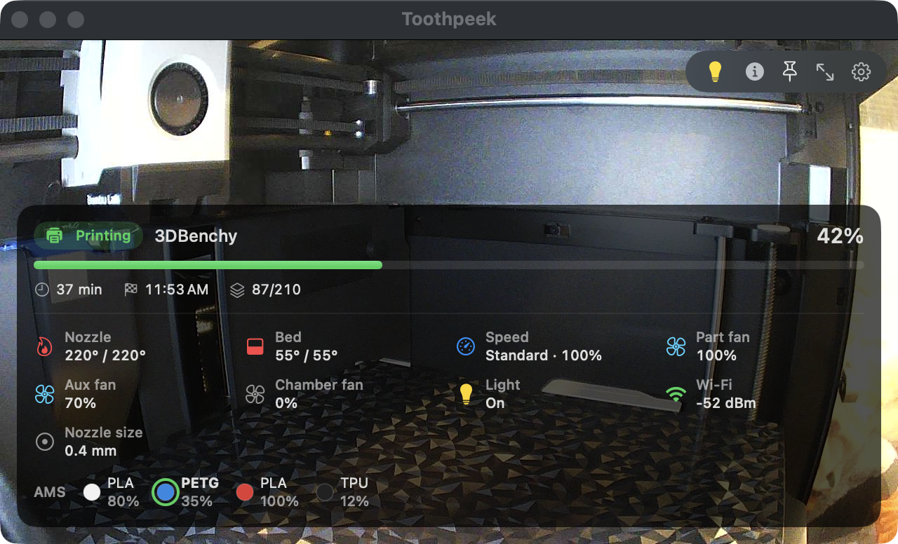
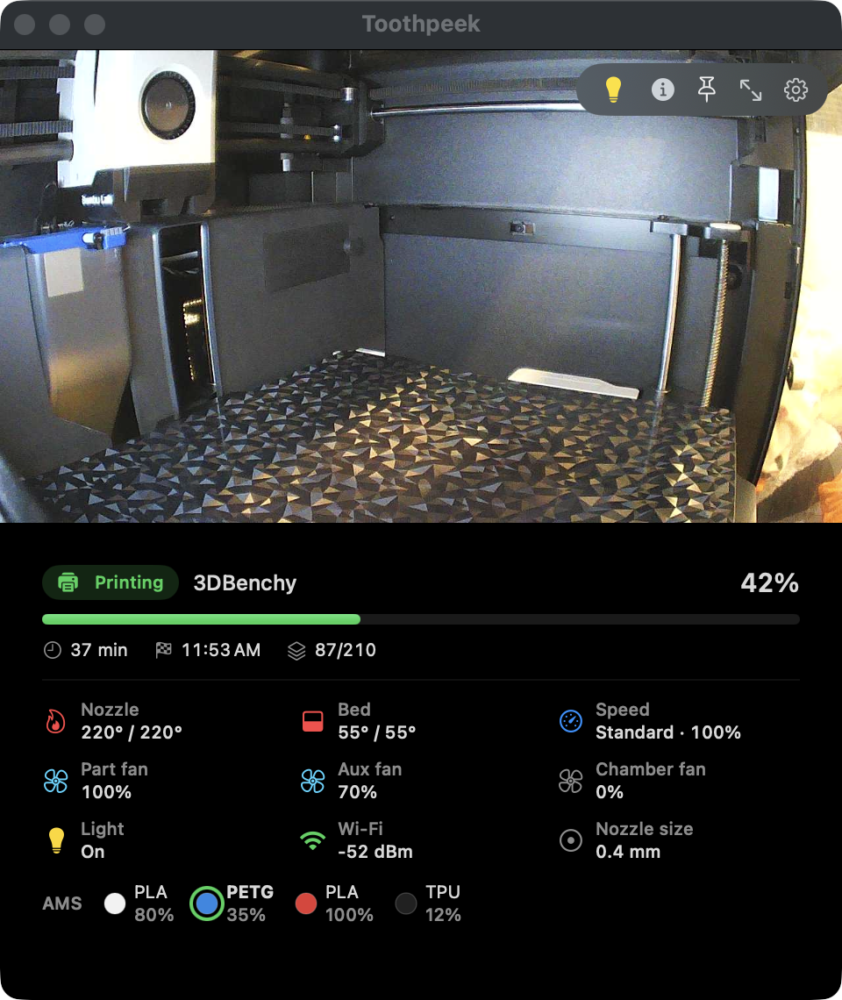

# Toothpeek

A quick _peek_ at your 3D printer from the Mac menu bar: live camera, print progress and notifications. Built for Bambu Lab printers on your local network; so far it has only been tested on a P1S.

<p align="center">
  
  
</p>
<p align="center"><sub>A wide window shows the print info over the image, a tall one shows it underneath. Camera image from a P1S, print info simulated.</sub></p>

Toothpeek is an independent project, not affiliated with or endorsed by Bambu Lab. "Bambu Lab" is a trademark of its owner, mentioned only to describe compatibility.

**Why "Toothpeek"?** A toothpick is a tiny stick, often made of bamboo, that you barely notice. Say "toothpick" out loud and you hear "tooth-*peek*": a small tool for a quick peek at your printer.

## Features

- **Live camera** in a window you can resize, make full screen, and pin above other windows on its desktop or on all desktops. Hover the image for a magnifier.
- **Menu bar icon** whose color follows the printer state. Click it to show the camera window, double-click it to bring the window back under the icon (handy when it is lost on another screen), right-click it for the menu.
- **Print progress**: state, percent, time left, estimated end, layer, temperatures, fans, AMS spools.
- **macOS notifications** when a print starts, pauses, resumes, is canceled, fails or finishes (with a camera snapshot), and when the printer goes online or offline.
- **Light background monitoring**: status only (MQTT, a few KB). No video is pulled while no window is open.
- **Chamber light switch** in the camera window.
- **Update check**: once a day Toothpeek looks for a newer release on GitHub and tells you how to update (Homebrew command or download link). It never installs anything by itself.
- Automatic printer discovery, English and French interface, optional launch at login.

Everything stays on your local network and Toothpeek does not use Bambu's cloud. It only reads from the printer, except for the chamber light switch. Protocol details: [docs/protocol.md](docs/protocol.md).

## Install

With [Homebrew](https://brew.sh):

```sh
brew install --cask loicbisiere/tap/toothpeek
```

Or download `Toothpeek-<version>.zip` from the [latest release](https://github.com/loicbisiere/toothpeek/releases/latest), unzip it and move `Toothpeek.app` to `/Applications`.

**First launch:** Toothpeek is not notarized by Apple yet, so macOS blocks it the first time. Open Toothpeek once, then go to **System Settings > Privacy & Security** and click **Open Anyway**. macOS remembers the choice.

On first launch the window opens on the settings: enter your printer's IP address and access code (or pick the printer found on your network). Get back to them later with the gear button in the window, a right-click on the menu bar icon, or ⌘,.

## Requirements

- macOS 14 or later, on the same local network as the printer.
- A Bambu Lab printer, see [Compatibility](#compatibility).
- The printer's IP address and 8-character access code, shown on the printer screen under Settings > WLAN. LAN Only mode is not required.

## Compatibility

Only the P1S has been tested so far. Reports for other models are welcome.

| Printers                  | Camera                                                                                            | Print status and notifications                         |
| ------------------------- | ------------------------------------------------------------------------------------------------- | ------------------------------------------------------ |
| P1S                       | Tested                                                                                            | Tested                                                 |
| P1P, A1, A1 mini          | Should work: same camera protocol as the P1S. Not tested.                                         | Should work. Not tested.                               |
| P2S, X1 series, H2 series | Not supported yet: these printers stream their camera over RTSP, which Toothpeek does not read (yet). | Probably works (same MQTT status service). Not tested. |

## Build from source

Requires the Xcode Command Line Tools (`xcode-select --install`); the full Xcode app is not needed.

```sh
./bundle.sh           # builds build/Toothpeek.app (universal: Apple silicon + Intel)
./bundle.sh install   # same, then installs it in /Applications
swift run             # runs without building the app bundle
```

`bundle.sh` signs the app with your "Apple Development" certificate if you have one, and ad hoc otherwise. `VERSION` and `BUILD_NUMBER` set the app version.

Command-line checks, using the `BAMBU_IP` and `BAMBU_ACCESS_CODE` environment variables:

```sh
swift run Toothpeek --snapshot frame.jpg   # save one camera frame
swift run Toothpeek --status               # print the current print status
swift run Toothpeek --discover             # list printers announcing themselves on the network (15 s)
swift run Toothpeek --light on             # switch the chamber light (on/off) and confirm the new state
```

## Releasing

GitHub Actions ([`.github/workflows/build.yml`](.github/workflows/build.yml)) builds the app on every push and pull request. Pushing a version tag publishes a release:

```sh
git tag v0.2.0
git push origin v0.2.0
```

The workflow then creates the GitHub Release with `Toothpeek-0.2.0.zip` and updates the cask in [loicbisiere/homebrew-tap](https://github.com/loicbisiere/homebrew-tap) from [`packaging/homebrew/toothpeek.rb`](packaging/homebrew/toothpeek.rb). The tap update needs a `HOMEBREW_TAP_TOKEN` secret: a fine-grained token with "Contents: read and write" access to the tap repository.

## Security

The access code Toothpeek needs also grants full control of the printer, so Toothpeek protects it:

- It is stored in the login Keychain, not in the preferences.
- It is only sent to a genuine Bambu printer: the printer's TLS certificate must be signed by a Bambu certificate authority (bundled with the app), and its serial number must match the one seen on the first connection. Another device, or another printer at the same address, is refused until you save the settings again.
- Toothpeek only reads from the printer, apart from the chamber light command, sent only when you click the light button. It opens no listening port except to receive the printers' network announcements. Outside your network, it only contacts `api.github.com` once a day to check for updates (can be turned off in Settings).
- Notification images can be turned off in Settings (they show the inside of the printer and can appear on the lock screen).

## Known limitations

- Release builds are not signed with a Developer ID, so macOS asks again for Keychain access to the access code after each update. Click "Always Allow".
- P1 cameras deliver about 1 frame per second.
- No access from outside the local network; use a VPN to the printer's network.
- A macOS desktop widget was tried and removed: [docs/widget.md](docs/widget.md).
- With only the Command Line Tools, SwiftUI's `@State` macro is unavailable, so the code uses `ObservableObject` instead.

## Roadmap

- **Multiple printers.** I only have one printer for now, so I can't test this yet.
- **Configurable refresh rate** for the camera and status updates.
- **More printer commands**, e.g. fan speed. The chamber light switch was the first test: Bambu's Authorization Control does not block it (P1S, firmware 01.10.00.00, without Developer Mode). Each new command still needs checking, since recent firmware blocks control commands such as starting a print or moving the axes from third-party apps (see [Authorization Control](docs/protocol.md#authorization-control)).

## License

MIT, see [LICENSE](LICENSE).
